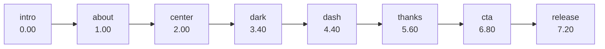

# Product brief

## 1. What this is

A one-page portfolio for **Ezekiel "Zeke" Bustamante**, a Computer Engineering student at PUP Manila
working in cybersecurity and full-stack development.

The differentiator is not the content — it's the delivery. Rather than a stack of sections, the page
is a **guided tour narrated by a 3D character who looks like the author**. Scrolling advances a story;
in the middle of it, the character steps aside and a dashboard of real work slides in; at the end he
turns to camera and waves.

### Audience

| Audience | What they came for | Where they get it |
| --- | --- | --- |
| Recruiters / hiring managers | Role, focus, credibility, contact | `about` scene, `experience` + `certifications` tabs, CTA |
| Hackathon organisers & collaborators | Shipped work, awards | `projects` tab, Overview highlight counts |
| Fellow students / org members | Leadership history, writing | `experience`, `blogs` tabs |
| Anyone who clicked a shared link | A memorable 60 seconds | The story itself |

### Goals

1. **Prove capability in under a minute** — the profile card, awards, and stack are reachable in
   two interactions from the dashboard.
2. **Be memorable without being obstructive** — the 3D and scroll choreography must never block a
   recruiter from reaching email or LinkedIn.
3. **Stay honest** — placeholder features are visibly labelled as placeholders (see §5).

### Non-goals

- Multiple routes. There is one page; navigation is anchor links mapped onto story scenes.
- A real AI chatbot. The chat panel is a UI shell (§5).
- A CMS. Content is typed constants in one file.
- A blog engine. Blog entries link out or read "Coming soon".

### Success criteria

- The hero model reaches its resting pose and the intro copy is legible on a mid-range phone.
- Email and LinkedIn are reachable without scrolling through the story (`Let's talk` in the navbar).
- With WebGL disabled or the model failing, the page still tells the whole story.
- With `prefers-reduced-motion`, no scroll lock, no scrub, no drop-in — the page becomes a plain
  document.

---

## 2. The story

Seven labelled scenes over a 7.2-unit timeline, pinned for **8.64 viewports** of scrolling
(`PIN_END 7.2 × SCROLL_PER_UNIT 1.2`).



| Scene | Enters at | Copy / content | Character | Camera |
| --- | --- | --- | --- | --- |
| `intro` | 0.0 | Name loader → headline, intro paragraph, two buttons | Drop-in animation, then idle; head follows cursor | Full body, centred |
| `about` | 1.0 | "Secure by habit, curious by default." + 3 facts | Idle beside the text column | Full body, shifted left |
| `center` | 2.0 | Text clears | Walks back to centre, laughs | Full body, centred |
| `dive` | 2.6 → 3.45 (*derived*) | — | Mouth opens as the camera approaches (dive itself starts at 2.05) | Dives into the mouth |
| `dark` | 3.4 | Screen goes black at 3.12, dark backdrop at 3.35 | Hidden during the cut | Cut behind black |
| `dash` | 4.4 | Dashboard window rises | Waist-up, turned toward the panel | Bust framing beside the panel |
| `thanks` | 5.6 | "Thank you for listening." slide over the panel | Idle | Bust framing |
| `cta` | 6.8 | "Let's build something secure." + buttons | Turns to camera, waves | Pulls back to full body |
| *release* | 7.2 | Story ends, page un-pins, footer takes over | Outro framing | Full body |

Scene detection uses a **second, coarser** table (`SCENES`) rather than the label times, because a
label marks where content *changes* while the scene should become active slightly *after* that:

```
t < 0.5 intro · t < 1.3 about · t < 1.9 moving · t < 2.6 center
t < 3.45 dive · t < 5 dash · t < 6.2 thanks · else cta
```

`moving` and `dive` are transitional states with no UI of their own; they exist so the character's
reactions and gestures can be suppressed mid-transition.

### Scene → behaviour

| Event | Reaction |
| --- | --- |
| Enter `intro` / `about` | Character plays `Talk` |
| Enter `center` | Character plays `Laugh`, then auto-advances to `dash` after 2s |
| Enter `dark` | Screen black; the cut to the dashboard happens out of sight |
| Enter `dash` | Character re-speaks the last dashboard insight |
| Enter `thanks` | "Thanks for sticking around! That's the tour." |
| Enter `cta` | "That's me. Got a project, a hackathon team, or a role? Let's talk." + `Wave` |
| Navbar | Hidden from timeline position 2.05 until the story leaves; dark tone over the ending |

### Navigation

The navbar, footer, and in-page buttons do not scroll to DOM elements — they jump to **timeline
labels**, then move focus into that scene for keyboard users.

| href | Label | Focus target |
| --- | --- | --- |
| `#top` | `intro` | `h1` |
| `#about` | `about` | `h2` |
| `#work` | `dash` | the selected dashboard tab |
| `#contact` | `cta` | the first link in the CTA panel |

Because `#work` and `#contact` have no corresponding DOM ids, these hrefs only work while the story
handler is attached. The skip link in [`app/page.tsx`](../app/page.tsx) points at `#work` for the
same reason.

---

## 3. Copy inventory

Every user-visible string, and where it lives. Copy lives in JSX for scenes and in `data.ts` for
dashboard content, so there is no single strings file.

**Loader** — `zeke.` (one letter per element, animated)

**Intro headline** — "Hi, my name is / Ezekiel Bustamante." (second line underlined by an animated
SVG stroke)

**Intro paragraph** — "I'm Zeke — a Computer Engineering student at PUP Manila building secure,
full-stack web apps, with a soft spot for cybersecurity and AI."

**Intro actions** — "See my work" → `#work` · "Get in touch" → `#contact`

**About headline** — "Secure by habit, curious by default." ("curious" in brand green)

**About paragraph** — "I wrote my first Hello World in 2024, before college even started. Since then
I've led technology teams across various organizations and shipped full-stack projects that placed
at two hackathons. Now I'm pointing that builder's mindset at security through pentesting courses and
certifications, so what I ship holds up when someone tries to break it."

**About facts** — Based in: Metro Manila, PH · Studying: BSCpE, PUP Manila · Focus: Cybersecurity &
Full‑stack

**Speech bubble** — "Talk to me" (mobile) / "Psst — talk to me" (desktop)

**Closing slide** — "Thank you / for listening." · "Cybersecurity · Software Developer" ·
"Questions? Let's talk."

**CTA** — "Let's build something secure." · "Have a project, a hackathon team that needs a builder, or
an internship in mind? My inbox is open." · "Email me" · "LinkedIn"

**Character subtitles** — 16 lines keyed by insight, in
[`data.ts`](../sections/Dashboard/data.ts) `insights`. Every tab and every filter chip has one.

**Chat** — greeting plus four rotating placeholder replies. See §5.

**Footer** — `onlyzekedotcom@gmail.com` (huge mailto link), "Cybersecurity and software developer from
Metro Manila. Open to projects, hackathon teams, and internships.", Navigate, Elsewhere, "© 2026
Ezekiel Bustamante", "Back to top".

### Voice

First person, lowercase-comfortable, contractions, no em-dash-free formality. Sentence fragments are
fine in subtitles ("No public quotes yet."). The character speaks like the author, not like a mascot.

---

## 4. Interaction budget

The page asks a lot of the visitor on first load (a loader, a scroll lock, a 3D download). These
rules keep that fair:

- **4 MB model, 361 KB poster** — the model is the largest asset by far. It is lazily loaded and the
  intro proceeds after **2.5 s** without it; he drops in late rather than blocking the page.
- **The loader never traps you** — it exits once the name has shown and either the model is ready or
  2.5 s have passed.
- **Scroll is locked only during the ~4 s intro**, and the lock holds position instead of hiding the
  scrollbar, so there is no layout jump.
- **Returning visitors in the same session** skip the ceremony at 1.8×–2.5× speed.
- **Escape hatches everywhere** — the navbar CTA works from any scene; the footer is one scroll past
  the story.

---

## 5. Feature status

Documented honestly so nobody mistakes a shell for a working feature.

| Feature | Status | Notes |
| --- | --- | --- |
| Scroll story, 7 scenes | **Live** | Core of the product |
| 3D character + camera rig | **Live** | 9 animation clips, 4 idle gestures |
| Dashboard, 6 tabs | **Live** | Overview, Projects, Experience, Certifications, Blogs, Testimonials |
| Filters (projects, experience, blogs) | **Live** | Each filter triggers its own spoken line |
| Character subtitles | **Live** | GSAP `TextPlugin` typewriter |
| Dark / light theme | **Live** | Persisted in `localStorage`, no flash |
| Chat panel | **Shell** | Focus-trapped, animated, replies are four canned strings |
| Testimonials | **Empty by design** | Renders an empty state with an email link |
| Blog posts | **Coming soon** | All 5 entries have no `href`; each renders a "Coming soon" chip |
| Mobile app projects | **None** | `projects:Mobile` filter exists and says so |
| Analytics / contact form / backend | **Absent** | Email is a Gmail compose link |

---

## 6. Content source

Dashboard content is transcribed from `heyzeke.me` and `github.com/defzeke/my-portfolio`. Awards
referenced: 1st Runner-Up at PUP Hackathon (VerdePM), Top 8 at ICTO Hackathon (Blockbayan).

> One inconsistency is live today: the Blockbayan blog title says "Top 8 of 31" while the project card
> says "Top 8 of 32". Tracked in [known issues](./known-issues.md).
