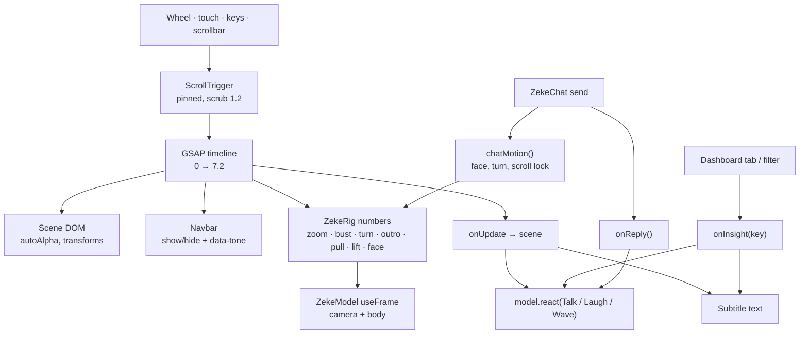
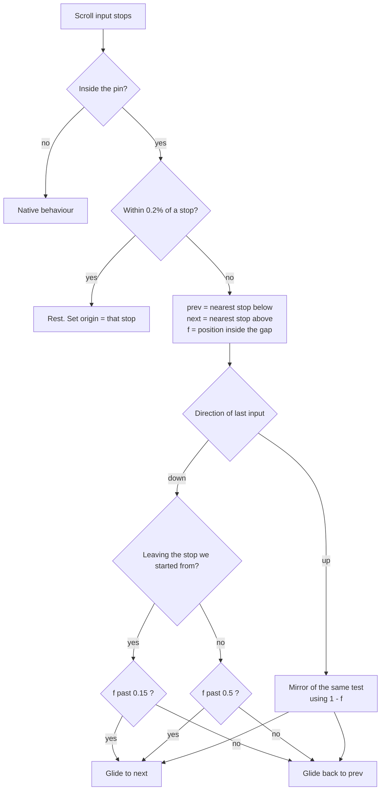
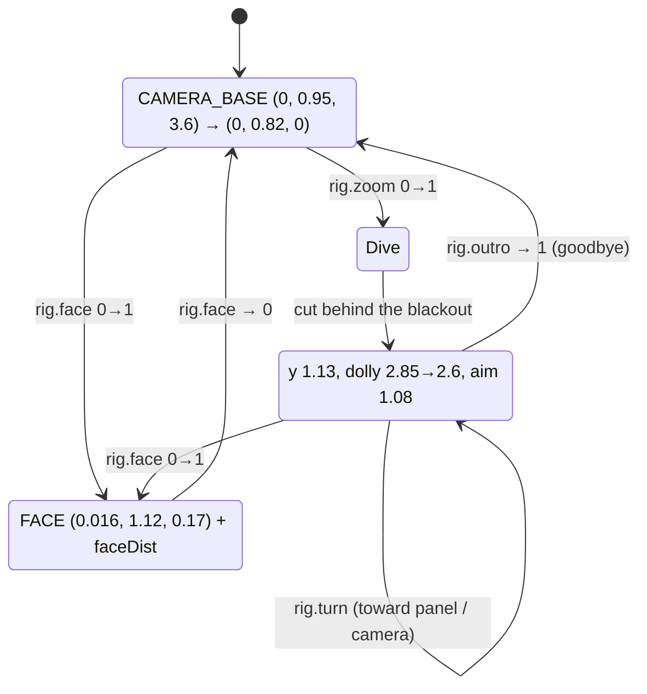
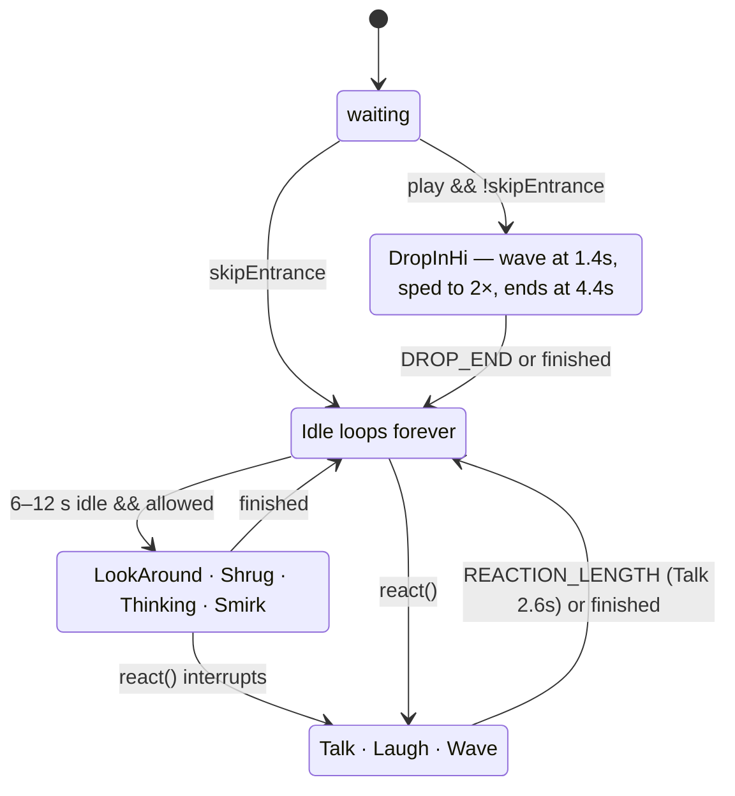
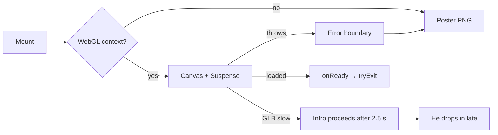
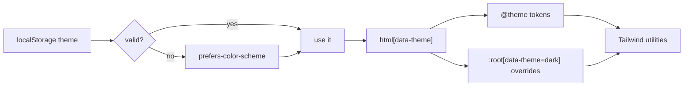

# System overview

How the page is built, how scroll drives a 3D character, and where every concern lives.

---

## 1. Stack and rendering

### 1.1 Dependencies

| Package | Version | Role |
| --- | --- | --- |
| `next` | 16.4.3 | App Router, Turbopack, font + asset optimisation |
| `react` / `react-dom` | 19.3.0 | UI, with React Compiler enabled |
| `gsap` | 3.15 | The entire story: `ScrollTrigger`, `ScrollToPlugin`, `TextPlugin` |
| `@gsap/react` | 2.1.2 | `useGSAP` for scoped, auto-cleaned animations |
| `three` | 0.187 | WebGL |
| `@react-three/fiber` | 9.8 | React renderer for three |
| `@react-three/drei` | 10.7 | `useGLTF`, `Environment`, `Lightformer`, `ContactShadows` |
| `tailwindcss` + `@tailwindcss/turbopack` | 4 | Styling via a Turbopack loader rule |
| `babel-plugin-react-compiler` | 1.0.0 | Auto-memoisation |
| `eslint` / `eslint-config-next` | 9 / 16.4.3 | `core-web-vitals` + TypeScript rules |

There is no state library, no router, no data layer, and no CMS. Everything is local.

### 1.2 Directory map

```
app/
  layout.tsx        Root shell: fonts, metadata, pre-paint theme script
  page.tsx          The only route: skip link + Navbar + <main><Hero/> + Footer
  globals.css       Tokens (@theme), dark overrides, utility layers, keyframes

components/
  common/Navbar.tsx        Fixed bar; tone controlled by the story via [data-nav]
  common/Footer.tsx        Dark footer with the huge email link
  common/ThemeToggle.tsx   Data-attribute + localStorage toggle
  ui/Button.tsx            Anchor styled as a pill (3 variants)

sections/
  Hero/
    Hero.tsx       ≈44 KB. Loader, scenes, GSAP timeline, scroll engine, chat orchestration
    HeroCanvas.tsx SSR-off dynamic boundary around the canvas
    HeroScene.tsx  Canvas, lights, environment, WebGL detection, error boundary, poster
    ZekeModel.tsx  GLB, animation state machine, camera rig, cursor follow, mouth sync
    clipFixes.ts   Runtime repairs for two broken animation clips
    Subtitle.tsx   Typewriter line under the character
    ZekeChat.tsx   Focus-trapped chat dialog (placeholder replies)
  Dashboard/
    Dashboard.tsx  Tabs, panels, filters, previews, empty states
    data.ts        All content + the insight (spoken line) map

public/
  models/zeke.glb              4.0 MB, the character that ships
  models/zeke_rigged_web.glb   11.4 MB, unused
  images/zeke-poster.png       361 KB, WebGL fallback

docs/                        This documentation
```

### 1.3 Server / client boundary

Only the page shell is a server component.

| Component | Boundary | Notes |
| --- | --- | --- |
| `app/layout.tsx` | Server | Emits an inline `<script>` before paint |
| `app/page.tsx` | Server | Renders `Navbar`, `Hero`, `Footer` |
| `Navbar` | Server | Links + `ThemeToggle` (the only client child) |
| `Footer` | Server | Static |
| `ThemeToggle` | Client | Reads/writes `document.documentElement.dataset.theme` |
| `Hero` | Client | Owns the timeline and all scene state |
| `Dashboard` | Client | Tab + filter state |
| `HeroCanvas` → `HeroScene` | Client, `ssr: false` | Avoids evaluating WebGL on the server |
| `ZekeModel` | Client | `useFrame` per-frame loop |

`LayoutProps<"/">` in `layout.tsx` is Next 16's generated route typing rather than a hand-written
`{ children: ReactNode }`. Keep it.

### 1.4 Fonts and metadata

Three Google fonts are loaded through `next/font/google` in `layout.tsx` and exposed as CSS variables,
consumed by `@theme` in `globals.css`. Bricolage Grotesque requests the `opsz` and `wdth` axes — that
is what makes the display face get chunkier at large sizes.

Metadata: title "Ezekiel Bustamante — Cybersecurity & Software Developer", description "Zeke's
portfolio: a Computer Engineering student at PUP Manila building secure, full-stack web apps."

### 1.5 Build configuration

```ts
// next.config.ts
cacheComponents: true,
partialPrefetching: true,
reactCompiler: true,
turbopack: { rules: { "*.css": { loaders: ["@tailwindcss/turbopack"], as: "*.css" } } }
```

Verified against the bundle docs in `node_modules/next/dist/docs`:

- **`cacheComponents`** enables Cache Components (Next 16). Under it, **Partial Prerendering is the
  only rendering model** for App Router pages, and the older caching/revalidation model does not
  apply. This app barely notices because it fetches nothing — but it does mean any future dynamic
  data must be modelled with `use cache` / `cacheLife` / `cacheTag` instead of `fetch` options.
- **`partialPrefetching`** only works with `cacheComponents`, and Next logs a warning if it is left
  unset. Both flags are slated to be always-on in the next major, at which point the options are
  removed. Re-check this on every Next upgrade ([known issues](./known-issues.md)).
- **`reactCompiler`** enables automatic memoisation via `babel-plugin-react-compiler`.
- **Turbopack CSS rule** is what wires Tailwind 4 into `next dev`/`next build` without a PostCSS
  config in the repo.

Import alias: `@/* → ./*` (see `tsconfig.json`).

---

## 2. Data flow

There is no store. Four imperatively-connected units exchange a handful of refs and callbacks.



Two rules keep this sane:

1. **GSAP writes, React renders.** The timeline mutates DOM and plain-number rigs directly. React
   state is reserved for things that change *structure*: which dashboard view is open, the current
   subtitle, whether chat is open.
2. **One owner per concern.** The timeline alone decides navbar visibility and tone. `Dashboard`
   alone owns tab/filter state. `ZekeModel` alone writes camera position and bone rotations.

---

## 3. Scroll story engine

All of it lives in the first `useGSAP` block of [`sections/Hero/Hero.tsx`](../sections/Hero/Hero.tsx)
(lines ~155–680).

### 3.1 The pin

```ts
scrollTrigger: {
  trigger: root.current,           // <section id="top"> with h-svh
  start: "top top",
  end: () => `+=${innerHeight * PIN_END * SCROLL_PER_UNIT}`,   // 8.64 viewports
  pin: true,
  scrub: 1.2,
  invalidateOnRefresh: true,
}
```

Because the root is `h-svh`, pinning it means the page does not move while the story plays. Scroll
position becomes **time**. `SCROLL_PER_UNIT` (1.2) is the exchange rate: one timeline unit costs 1.2
viewports of scrolling.

A hidden `<div ref={reserve}>` with `height: 864svh` is rendered *before* the story initialises, so
the scrollbar exists at the right length from the first paint and does not resize when the pin is
created. It is removed (`display: none`) the moment scrolling is enabled.

`ScrollTrigger.config({ ignoreMobileResize: true })` stops the whole pin from re-measuring (and
jumping) when a phone's address bar hides.

### 3.2 Labels versus scenes

Two tables, deliberately different:

- `AT = { intro: 0, about: 1, center: 2, dark: 3.4, dash: 4.4, thanks: 5.6, cta: 6.8 }` — where
  content changes on the timeline.
- `SCENES` — progress thresholds that map "where am I" to a `Scene` for reactions and UI.

`SCENES` is *offset* from `AT`: `about` content appears at 1.0 but the scene becomes `about` at 1.3,
so the character does not react while the transition is still running. There are two extra
transitional scene names with no UI: `moving` (1.9–2.6) and `dive` (2.6–3.45).

`sceneAt(t)` is a linear scan over `SCENES`, defaulting to `cta`.

### 3.3 Stops

`stopsNow()` is derived at runtime from the timeline's own labels, **excluding `dark`**, plus `1.0`
for the release:

```
0.000  intro
0.139  about
0.278  center
0.611  dash      ← note the long empty gap: you cannot rest mid-dive
0.778  thanks
0.944  cta
1.000  released
```

Excluding `dark` is deliberate. The dive is a committed action, not a destination; allowing it as a
resting point would strand the visitor mid-camera-move.

### 3.4 Scene gating

Custom gating replaces native scroll snapping (which fights the pin and the smooth scrub).



In words: a small nudge away from the scene you were on is enough to move on; skipping *over* a scene
you never stopped at requires a much bigger push. Either way you never travel more than one stop.

Supporting state:

| Ref / var | Purpose |
| --- | --- |
| `origin` | Progress of the stop this gesture started from |
| `lastDir` | `1` down / `-1` up, from the most recent wheel/touch/key input |
| `lastInput` | Timestamp, used to debounce settle and detect a fresh gesture |
| `settleCall` | The pending `gsap.delayedCall` that runs `settle()` |
| `travel` / `travelTo` | The in-flight `goTo` tween and its destination label |

Input listeners: `wheel`, `touchstart`, `touchmove`, `keydown`, `scroll`, plus GSAP's own
`scrollEnd` event. Scrollbar drags are covered by reading `trigger.direction` in the `scroll` handler.

### 3.5 Glides (`goTo`)

`goTo(label)` scrolls to `st.labelToScroll(label)` (or `st.end + 2` for `null`, i.e. the footer) with
`ScrollToPlugin`, `autoKill: false`, and a duration interpolated from the distance:

```
duration = clamp(0.6, 1.8, 0.45 + distance * 0.6)     // 0.45 s under prefers-reduced-motion
```

On completion it resets `origin`, clears `travel`, re-arms auto-advance if parked on `center`, and
moves focus into the target scene (`focusFor(label)`) so keyboard users land inside what they jumped
to.

Any genuine scroll input during a glide cancels it (`takeOver` → `travel.kill()`), which is why an
impatient scroll never fights the animation.

### 3.6 Anchor interception

The story installs one delegated `click` listener on `document`. If the click lands on an
`a[href^="#"]` whose href is in

```ts
{ "#top": "intro", "#about": "about", "#work": "dash", "#contact": "cta" }
```

it prevents the default jump and calls `goTo(label, { focus })`. This is the entire routing layer of
the site. Outside the pin (after release) the handler still runs, so `#top` from the footer glides
back up the whole story instead of teleporting.

Note that `#work` and `#contact` have **no DOM ids** — they only mean something to this handler.

### 3.7 Scroll lock

`lockScroll(on)` is used twice: during the ~4 s intro, and while the chat is open.

It never sets `overflow: hidden`, because that removes the scrollbar, narrows the page, and makes the
model jump. Instead it:

1. Records `window.scrollY` in `lockedAt`.
2. Sets `documentElement.dataset.scrollLocked` (a debugging/style hook; no CSS depends on it today).
3. Adds non-passive `wheel` / `touchmove` / `keydown` listeners that `preventDefault()` —
   except inside `input`, `textarea`, `[contenteditable]`, or `.scroll-quiet` (the dashboard panel).
4. Adds a `scroll` listener that forces the position back (`holdPosition`).

`html { overflow-y: scroll }` guarantees the scrollbar is always present, so nothing shifts.

### 3.8 Navbar ownership

`setNav(show, tone)` is the single writer of the navbar. It is called from:

| Trigger | Result |
| --- | --- |
| `onUpdate`, progress < 1 | Hidden after `NAV_HIDE_AT` (2.05) |
| `onLeave` (past the story) | Shown, `tone="dark"` |
| `onEnterBack` | Shown, light unless before 2.05 |
| `onLeaveBack` | Shown, light |
| Intro timeline | Shown at the "actions" beat |

Tone is written as `data-nav` → `[data-nav][data-tone="dark"]` rules in `globals.css`. Components
never set tone themselves.

### 3.9 Auto-advance

Parked on `center`, `armAuto()` schedules a `gsap.delayedCall(2)` that glides to `dash` over 2.6 s.
It is cancelled by any input, any nav glide, and any scene change. This is what makes the story feel
like it is *carrying* you rather than waiting for you.

### 3.10 Lifecycle

Three timelines, chained by flags rather than nested callbacks:

```
1. name loader      → flags.nameShown
2. tryExit()        → waits for nameShown && (modelReady || waited 2.5 s)
   ├─ model still loading → entranceDone() immediately, he drops in later
   └─ model ready        → waits for onEntranceComplete
3. entranceDone()   → slides the stage aside, reveals intro, enables scroll
```

`finish(tl)` jumps a timeline to the end under reduced motion. Everything registered through
`contextSafe` is reverted in `useGSAP`'s cleanup, which also releases the scroll lock and removes
every listener.

---

## 4. 3D pipeline

### 4.1 Canvas and scene

[`HeroCanvas`](../sections/Hero/HeroCanvas.tsx) is a four-line `next/dynamic` wrapper with
`ssr: false`. [`HeroScene`](../sections/Hero/HeroScene.tsx) does the real work:

- **WebGL detection** at mount (`webgl2` or `webgl`); if absent, renders the poster.
- **Error boundary** around the canvas; a thrown error also falls back to the poster.
- **DPR cap**: `1.4` on ≤767 px, `1.75` otherwise (`dpr={[1, maxDpr]}`).
- **Frameloop pausing**: an `IntersectionObserver` on the wrapper switches `frameloop` between
  `"always"` and `"never"`, so the GPU idles once the hero scrolls away.
- **Camera**: `fov 30`, `near 0.005` (small enough to travel inside the mouth), `far 50`, positioned
  from `CAMERA_BASE`.
- **Lighting**: ambient 0.5, key directional 1.6 from `(2.5, 4, 3)`, green-tinted fill 0.8 from
  `(-3, 2, -2)`, plus a 256 px `Environment` built from three `Lightformer` rectangles in white and
  `#bbf7d0`. No HDRI file.
- **Ground**: `ContactShadows` at `y = 0`, opacity 0.35, tinted `#14532d`.

### 4.2 The model

[`ZekeModel`](../sections/Hero/ZekeModel.tsx) loads `/models/zeke.glb` via `useGLTF` (and preloads
it at module scope).

- 1.5 world units tall, feet at `y = 0`, facing **+Z**.
- `group.rotation.y` = `rig.turn + yaw * BODY_YAW`.
- Frustum culling is disabled on every mesh: skinned bounds do not follow the drop-in animation, so
  culling would pop him out of frame.
- Bones used by name: `Head`, `Neck`, plus hand/finger bones for the clip repairs.
- Mouth interior: `Tongue` and `Teeth_Lower` are morph followers. The GLB ships `jawOpen` and
  `tongueOut` baked at 100%, which pushes the tongue through the chin; `syncMouth()` forces
  `tongueOut = 0` and drives both meshes' `jawOpen` from the face mesh's `jawOpen` each frame.

### 4.3 Camera rig

The page never touches the three.js camera. It writes eight numbers into `rigRef.current` and
`useFrame` composes them:

| Field | Written by | Effect |
| --- | --- | --- |
| `zoom` | Dive tween | 0→1 dives from full body into the mouth |
| `bust` | Dashboard cut | >0 switches to the waist-up framing (takes priority over `zoom`) |
| `turn` | Dashboard cut / chat / CTA | Body yaw in radians |
| `outro` | CTA tween | Blends the bust framing back to the opening full-body shot |
| `pull` | Phone framings | Adds camera distance without resizing the canvas |
| `lift` | Phone framings | Lowers camera + aim, moving him up the screen |
| `face` | Chat | 0→1 close-up on `FACE` |
| `faceDist` / `faceLift` | Chat | Close-up distance and vertical bias |



Phone framings are applied *after* the base composition, by translating the camera:

| Constant | Values | Used for |
| --- | --- | --- |
| `MOBILE_ASIDE` | `pull 4.2`, `lift 0.96` | Intro / about: full body in the top ~40% |
| `MOBILE_BUST` | `pull 6.3`, `lift 1.55` | Dashboard / CTA: waist-up above the window |
| `FACE_DESKTOP` | `faceDist 1.9`, `faceLift 0.09` | Chat, desktop |
| `FACE_PHONE` | `faceDist 3`, `faceLift 0.33` | Chat, phone |

This pull/lift scheme exists because resizing the canvas mid-story glitches the render. Phones get a
wider camera, never a different canvas size.

The dive target is a `THREE.Object3D` parented to the `Head` bone, positioned at the world-space
centre of the **upper teeth** geometry (computed through the skinned mesh's bind matrix and bone
inverse so it survives quantised exports). This is why the camera lands correctly no matter what the
animation is doing to the head. The target leads the camera early (`smoothstep(0, 0.45, zoom)`),
then the camera travels the rest of the way to just behind the lips.

### 4.4 Animation state machine

Clips shipped in the GLB and used: `DropInHi`, `Idle`, `Talk`, `Laugh`, `Wave`, `LookAround`,
`Shrug`, `Thinking`, `Smirk`.



Behaviour details:

- **Allowed** = not diving (`zoom > 0 && bust === 0`) and not chatting (`face > 0`). The camera is
  busy, so idle gestures are suppressed — but rescheduled, not skipped forever.
- `react()` is a no-op in `waiting`/`entrance`, and ignored if the same clip is already playing.
- `DropInHi` is time-scaled inside the clip: normal until 1.4 s (he lands), then 2× for the wave, cut
  at 4.4 s.
- `lastGesture` prevents the same gesture twice in a row.

### 4.5 Weight-managed blending

Not `crossFadeTo`. Every one-shot clip is a layer with an eased weight; **Idle always takes
`1 - Σ(others)`**:

```
each frame, before mixer.update:
  for each layer: weight += (target - weight) * (1 - e^(-dt * 7))
  retire layers whose target is 0 and weight < 0.002
  idle.weight = max(0, 1 - Σ layer weights)
```

Why: overlapping one-shots (scroll into `about` playing `Talk`, then `center` immediately playing
`Laugh`) can make naive crossfades sum below 1, which makes the mixer blend in the raw bind pose for
a frame — the "model glitches" bug. Filling the remainder with Idle makes that impossible.

Each clip name keeps a **pool of actions** (cloned clips). Replaying a clip that is still fading out
takes a fresh action rather than resetting the dying one to frame 0.

### 4.6 Cursor follow

The head tracks the pointer, but only while `mode === "idle"`, and the amount is gated by
`idleWeight` so it can never fight a clip's own head motion.

- Fade-in is slow (rate 2), fade-out fast (rate 8) — no whip-back after a clip.
- Max `yaw 0.7`, `pitch 0.35`; the body shares `BODY_YAW 0.25`.
- Turn step is capped at `2.5 rad/s` so a fast flick cannot snap the neck.
- The rotation is built in **world space** and converted to bone-local space
  (`L' = P⁻¹ · D · P · L`), so it works regardless of the rig's bone axis orientation.
- Before `mixer.update`, the previous frame's clip pose is restored, otherwise the applied yaw would
  accumulate forever on bones the clip does not re-write every frame.

### 4.7 Clip repairs

[`clipFixes.ts`](../sections/Hero/clipFixes.ts) fixes two clips that were exported wrong. Both run
once, before any action binds (`useEffect` ordering matters), and both restore the skeleton afterwards
so the real mixer binds to the rest pose.

| Clip | Problem | Fix |
| --- | --- | --- |
| `Thinking` | The chin hand points the wrong way | For every keyframe: re-aim the hand's long axis at the face, rebuild the palm so the back of the hand faces the viewer, and write the resulting quaternion back into the track |
| `Shrug` | Arms never leave the pockets | Add upper-arm / forearm / hand tracks that swing the arms out, plus `Hand.scale` keys (`0.001 → 1 → 0.001`) to "take the hands out of the pockets" |

Both use throwaway `AnimationMixer`s to pose the skeleton at exact clip times, then `uncacheRoot` and
restore. `userData.fixed` guards against double application.

### 4.8 Performance

| Lever | Setting |
| --- | --- |
| DPR | 1.4 phone / 1.75 desktop cap |
| Environment | 256 px procedural, no HDRI |
| Contact shadows | 256 px, `far: 2` |
| Frameloop | `never` when off-screen |
| Animation | Single mixer; idle weight shared across layers |
| Model | 4.0 MB, also preloaded at module scope |
| Materials | Whatever ships in the GLB; no runtime post-processing |

Deliberately absent: no post-processing, no `useGLTF` Draco step in code (the GLB must already be
compressed), no shadow maps.

### 4.9 Fallbacks

Layered, because each layer fails differently:



Under `prefers-reduced-motion`, `skipEntrance` is passed to the model: no `DropInHi`, no idle
gestures (`nextGestureAt = Infinity`), and the timelines finish instantly.

---

## 5. Content model

All copy that is not scene copy lives in
[`sections/Dashboard/data.ts`](../sections/Dashboard/data.ts):

| Export | Type | Consumed by |
| --- | --- | --- |
| `projects` | `Project[]` | Projects tab, Overview highlight counts |
| `projectCategories` | `["Web","Mobile","Game","AI"]` | Project filters |
| `profile` | object | Overview profile card (name, role, bio, availability, email) |
| `experience` | `{role, org, period, category, current?}[]` | Experience tab |
| `experienceCategories` | 4 values | Experience filters |
| `certifications` | `{name, org, href}[]` | Certifications tab |
| `blogs` | `{title, excerpt, category, date?, minutes?, href?}[]` | Blogs tab |
| `blogCategories` | 3 values | Blog filters |
| `testimonials` | `{quote, name, role}[]` | Testimonials tab (currently empty) |
| `now`, `stack` | display lists | Overview sidebar |
| `views` | 6 view ids | `View` type |
| `insights` | `Record<InsightKey, string>` | Subtitle lines |

**The coupling to remember:** every filter value must have an entry in `insights`, keyed as
`<view>:<category>` (e.g. `projects:AI`). TypeScript enforces this for the categories in the exported
tuples. Adding a category means adding both the tuple value and the insight line.

`InsightKey` is a union of `View | \`projects:${ProjectCategory}\` | \`experience:${ExperienceCategory}\`
| \`blogs:${BlogCategory}\``.

---

## 6. Dashboard

[`Dashboard.tsx`](../sections/Dashboard/Dashboard.tsx) renders a fake desktop window the character
stands beside.

- **Shell**: title bar (`zeke.` / current view), then a grid that is `grid-rows-[auto_1fr]` by default
  and `grid-cols-[180px_1fr]` at container width `@3xl/window`.
- **Container queries**, not media queries: the `@container/window` on the shell means the layout
  responds to the *window's* size, which is what actually matters inside the story. Panels inside use
  a second `@container` (`@sm`, `@lg`, `@2xl`, `@3xl`) so cards reflow independently.
- **Tabs**: real `role="tablist"` / `role="tab"` / `role="tabpanel"`, roving `tabIndex`, and
  Arrow/Home/End handling that wraps and scrolls the focused tab into view. The active tab is the
  focus target when someone navigates to `#work`.
- **State**: `view` plus one filter state per filterable tab (`Projects`, `Experience`, `Blogs`).
  Filters are local and reset when the view unmounts.
- **Every interaction speaks**: `open(view)` and `pick(filter)` both call `onInsight`, which bubbles
  to `Hero.say()` → subtitle typewriter + `Talk` reaction.
- **Empty states** are designed, not accidental: no mobile projects, no testimonials, no published
  blogs.

Accessibility note: the panel is a scroll container (`scroll-quiet`), and `lockScroll` explicitly
ignores wheel/touch inside `.scroll-quiet` so the dashboard remains scrollable while the page is
locked.

---

## 7. Theming



1. An inline script in `<head>` runs before first paint and sets `data-theme` on `<html>`, falling
   back to `prefers-color-scheme`. `<html>` ships with `data-theme="light"` and
   `suppressHydrationWarning` so React does not complain when the script changes it.
2. Tokens are declared once in `@theme`; dark mode **overrides the same custom properties** under
   `:root[data-theme="dark"]`. No component contains a `dark:` variant.
3. `ThemeToggle` flips the attribute and persists it, ignoring storage failures (private mode).
4. `color-scheme: dark` is set so native scrollbars and form controls follow.

The icon shows the theme you would switch **to** (moon in light, sun in dark) via CSS display rules,
not JS state — so the icon is correct even before hydration.

See [decision 0002](./decisions/0002-css-variables-over-dark-variant.md) for why.

---

## 8. Chat

[`ZekeChat`](../sections/Hero/ZekeChat.tsx) is a **presentation-layer shell**, not a chatbot.

What is real: the dialog semantics (`role="dialog"`, `aria-modal`, manual focus trap on Tab,
`Escape` to close), the typing indicator, the transcript scroll, and the orchestration with the
character — opening it locks scroll and dollies the camera to the face; each reply triggers
`react("Talk")`.

What is not: `REPLIES` is a four-item array cycled in order, delivered after 900–1500 ms. There is no
network call, no model, no API route. The greeting admits it ("Ask me about my projects…") and the
replies redirect to email/LinkedIn.

Two different openers feed it: the speech bubble in the intro and the small round button beside the
subtitle in the dashboard. `fromHero` distinguishes them so the bubble/scroll cue only animate when
they were the opener.

---

## 9. Where to make changes

| Goal | File |
| --- | --- |
| Scene timing, camera moves, scroll feel | `sections/Hero/Hero.tsx` (top constants) |
| Camera framings | `sections/Hero/ZekeModel.tsx` (`CAMERA_*`, `MOBILE_*`, `FACE_*`) |
| Animation behaviour | `sections/Hero/ZekeModel.tsx` (`GESTURES`, `REACTION_LENGTH`, `BLEND_RATE`) |
| Broken clips | `sections/Hero/clipFixes.ts` |
| Project / job / cert content | `sections/Dashboard/data.ts` |
| Spoken lines | `sections/Dashboard/data.ts` → `insights` |
| Colours, type, dark mode | `app/globals.css` |
| Dashboard layout and a11y | `sections/Dashboard/Dashboard.tsx` |
| Navbar tone | `app/globals.css` + `setNav` in `Hero.tsx` |
| Metadata, fonts | `app/layout.tsx` |
